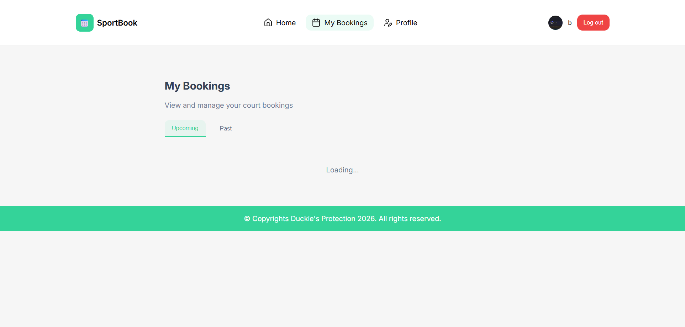

# Selenium tests for Sport Court Booking

Browser tests for the [Sport Court Booking application](https://github.com/thuttat/SPORT-COURT-BOOKING). The suite uses Python, pytest and Selenium WebDriver to exercise the React interface in Chrome.



## What the suite exercises

| Scenario | Examples | Test source |
| --- | --- | --- |
| Accounts | Registration validation, login errors and profile changes | [Authentication](tests/auth) · [User profile](tests/user) |
| Reservations | Select a date and slot, confirm a booking, encounter a time conflict or a quota limit | [Booking](tests/booking) |
| Cancellations | Check the booking before and after cancellation and attempt to access another user's booking | [Cancellation](tests/cancel) |
| Administration | Manage courts, check dashboard data and exercise access restrictions | [Admin](tests/admin) |

Trịnh Thị Anh Thư added browser test scenarios, page objects and screenshots. The shared [page objects](tests/pages) locate controls and perform common actions. The [end-to-end cases](tests/e2e/test_sel_e2e.py) combine actions across screens. [Contribution commit](https://github.com/thuttat/selenium-sport/commit/580034d77f16d560f5c3b0b20d4faa2344b450be) · [Screenshot archive](screenshots)

## Run locally

Start the [application and its seeded test database](https://github.com/thuttat/SPORT-COURT-BOOKING#run-locally) first. The suite expects the frontend at `http://localhost:5173` and a running backend at port 5000. Use a disposable instance because tests create users and modify bookings and courts.

With Chrome installed, activate a Python virtual environment in this repository, then run:

```sh
python -m pip install -r requirements.txt
python -m pytest tests/booking -v
python -m pytest tests/e2e -v
```

Run `python -m pytest tests/ -v` for the whole suite. The [driver fixture](conftest.py) opens a visible Chrome window. It checks for a local Windows driver and otherwise uses Selenium's default driver discovery. The committed images are evidence from earlier sessions.
